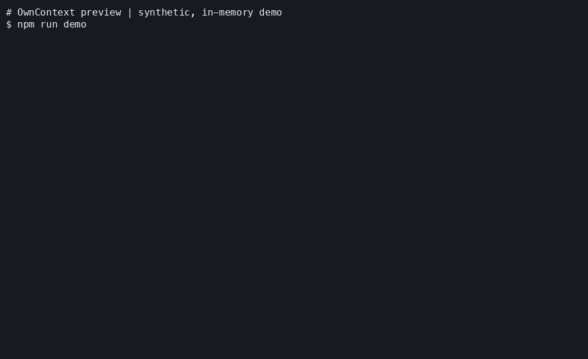

# OwnContext

[简体中文](README.zh-CN.md)

OwnContext lets developers who use multiple AI clients read and correct shared Markdown notes in a private GitHub repository through a single-user, self-hosted MCP server.

**Preview:** the local demo and live deployment, OAuth and MCP SDK checks pass; acceptance inside Claude Code and claude.ai is still pending.



24.5-second replay of real `npm run demo` output, paced for reading. Both tool clients and storage are in memory; this is not a live AI-client recording.

## Try it without accounts

From a [source checkout](https://github.com/clean99/owncontext), with **Node.js 24.11+** and npm:

```sh
npm ci --registry=https://registry.npmjs.org
npm run demo
npm run setup -- --dry-run
```

After dependency installation, both commands run offline. The demo uses synthetic notes to check duplicate suppression, correction and stale-SHA rejection. It starts no HTTP server and changes no repository. Setup's dry run prints the deployment plan without account access or configuration writes.

## Status: preview

Verified locally on macOS with Node 24: lint, type checking, unit/integration tests, a dry-run Worker build, and the demo/setup preview from a fresh local clone. MCP Streamable HTTP tests use the real Worker handler with fake GitHub/KV.

Verified on one live Cloudflare Workers deployment backed by a private GitHub repository, using standalone MCP SDK clients:

- OAuth discovery, public-client registration, owner-approved read/write consent and authorization-code + PKCE sign-in.
- Tool discovery, context loading, search and reads; synthetic note saving, duplicate suppression, current-SHA correction and stale-SHA rejection across two SDK connections.
- Token refresh, access-token and refresh-grant revocation, refusal of revoked tokens, and a successful `npm run doctor`.

Still pending: read/save/correction/conflict acceptance inside Claude Code and claude.ai, after the owner adds and authorizes the connector in each client. Linux CI is configured; native Windows is unverified. The GIF above demonstrates the local tool logic only.

## Why it exists

Context should survive a change of AI client. Markdown and Git keep it portable; `stated` and `inferred` labels separate your statements from deductions; source references make an answer traceable; SHA-checked updates let a client correct a note without overwriting a newer edit.

The server supplies storage and tools. Your client decides what to read and how to merge a correction. Labels and source references are client-supplied, not independent verification of a claim.

## Set up your own instance

Read the [quickstart](docs/en/quickstart.md) and [permissions](docs/en/permissions-and-scopes.md) before running:

```sh
npm run setup
```

Live setup needs Git, GitHub CLI, your GitHub and Cloudflare accounts, a GitHub OAuth App, and a repository-scoped token. It inspects those accounts and asks you to type `deploy` before creating resources or publishing the Worker. It can create a private notes repository, add missing synthetic template files, provision OAuth KV, and deploy. Existing template files are preserved.

Setup prints your endpoint, for example `https://owncontext.example/mcp`. Start with read-only consent. Writes require a separate checkbox on the consent page.

## Clients and platforms

| Surface | Current status |
| --- | --- |
| Local demo | Executable Node.js demo; exercised on macOS with Node 24 |
| MCP SDK over Streamable HTTP | Integration-tested against the real Worker handler with fake GitHub and KV |
| Claude Code and claude.ai | Connection instructions are provided by setup; live sign-in and cross-client operation still need release acceptance |
| Deployment | Cloudflare Workers with Workers KV and GitHub.com; no other hosting adapter |
| Setup CLI | Requires Node 24.11+, Git, `gh`, and bundled Wrangler; macOS exercised, Linux CI configured; native Windows not validated |

Other clients must support the same HTTP transport and OAuth flow. No stdio transport or legacy SSE endpoint is included. See [compatibility](docs/en/compatibility.md) for the exact verification boundary.

## Data flow and privacy

```text
MCP client → your Cloudflare Worker → your private GitHub repository
                ↓
            OAuth state in Workers KV
```

GitHub sign-in identifies the one allowed account. A separate fine-grained token gives the Worker repository access. Notes, corrections, and optional selected snippets remain in private Git history. Cloudflare processes requests; GitHub stores the files; a connected AI client can send returned context to its model provider under that provider's terms.

OwnContext makes no model calls and has no analytics service or automatic capture hook. Tool logs contain the tool name and status, not note bodies. Provider and CLI logging have their own controls. There is no application-level end-to-end encryption or automatic redaction. [Privacy and data flow](docs/en/privacy-and-data-flow.md).

## Tools

- Read: `get_context`, `search`, `read`.
- Write, with explicit OAuth write consent: `remember`, `update_note`.
- Optional, disabled by default: `capture_conversation`, `log_decision`, `log_meal`.

`update_note` requires the SHA from `read`, or `null` to create. A conflicting content change is rejected; the client must re-read and merge. `remember` suppresses exact repeated facts. Optional capture stores only the snippets the client supplies, with stable batch identifiers for retries; it does not collect conversations by itself.

## Costs

The software is free under Apache-2.0. You supply your own GitHub and Cloudflare accounts and pay any applicable storage, request, or platform charges. Free-tier eligibility and quotas depend on those providers. AI client subscriptions or model usage are separate. OwnContext does not set up billing or promise a zero-cost deployment.

## Limits and non-goals

- One allowed GitHub identity and one private repository; no team accounts or per-folder OAuth scopes.
- Plain UTF-8 text, at most 200 KiB per readable file; keyword substring search, not semantic or vector search.
- GitHub API latency and quotas apply. Search is paginated; a page with no matches can still have a continuation cursor.
- Sources and `stated`/`inferred` labels require client judgment. Corrections are client-authored; there is no automatic truth resolution.
- Rules files and `me/values.md` are protected from MCP writes. Git history retains old content; deleting a current file does not erase its history.
- No delete tool, scheduler, background collection, full conversation export, multi-file transaction, or hosted service operated by the maintainer.

## Documentation

- [Quickstart](docs/en/quickstart.md)
- [Privacy and data flow](docs/en/privacy-and-data-flow.md)
- [Permissions and scopes](docs/en/permissions-and-scopes.md)
- [Costs and limits](docs/en/costs.md)
- [Local benchmark method and raw samples](docs/benchmarks.json) (`npm run benchmark`; in-memory GitHub substitute, not deployed latency)
- [Upgrade and rollback](docs/en/upgrade-and-rollback.md)
- [Recovery and uninstall](docs/en/recovery-and-uninstall.md)
- [Compatibility](docs/en/compatibility.md)

## Development and license

```sh
npm run lint
npm run typecheck
npm test
npm run check:release
npm run build
```

See [CONTRIBUTING](CONTRIBUTING.md), [SECURITY](SECURITY.md), and [Code of Conduct](CODE_OF_CONDUCT.md). Licensed under [Apache-2.0](LICENSE), copyright clean99. See [NOTICE](NOTICE).
