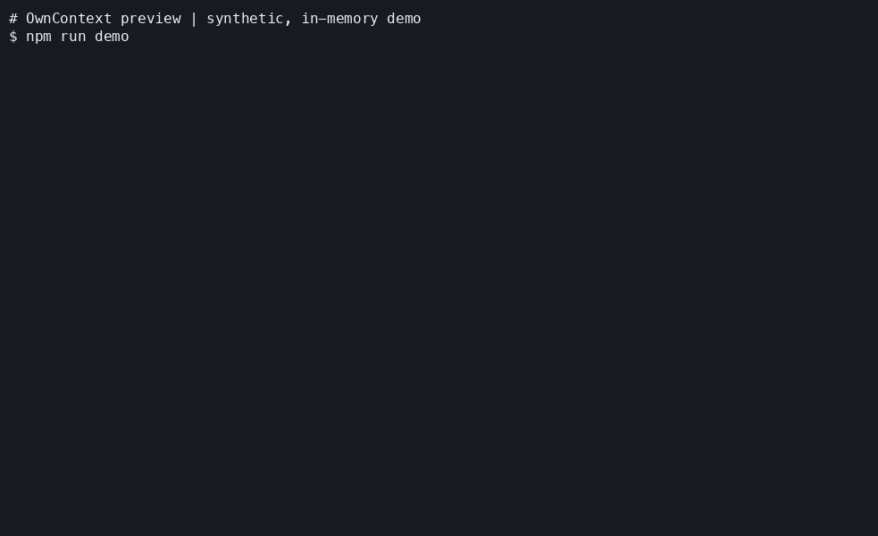

# OwnContext

[English](README.md)

OwnContext 面向使用多个 AI 客户端的开发者，通过单用户、自托管的 MCP 服务，让客户端共同读取和修正私有 GitHub 仓库里的 Markdown 笔记。

**预览版：** 本地 demo、真实部署、线上 OAuth 和 MCP SDK 检查已通过，Claude Code 与 claude.ai 客户端内验收仍待完成。



动图重放 `npm run demo` 的真实输出，放慢到 24.5 秒供阅读。两个工具客户端和存储均在内存中运行，演示范围仅限本地工具逻辑。

## 快速体验：免账号运行

准备[源码目录](https://github.com/clean99/owncontext)、**Node.js 24.11+** 及 npm，运行：

```sh
npm ci --registry=https://registry.npmjs.org
npm run demo
npm run setup -- --dry-run
```

安装依赖后，这两个命令均可离线运行。demo 用虚构笔记检查重复保存、修正和旧 SHA 冲突，数据留在内存，源码仓库保持原样。setup 预览只打印部署计划，账号和配置保持原样。

## 状态：线上 SDK 验收已通过

已在 macOS、Node 24 下验证 lint、类型检查、单元与集成测试、Worker 构建预演，以及全新本地克隆中的 demo 和 setup 预览。MCP Streamable HTTP 测试调用真实 Worker handler，GitHub 和 KV 使用测试替身。

已在一套真实 Cloudflare Workers 部署和私有 GitHub 仓库上，用独立的 MCP SDK 客户端通过以下检查：

- OAuth 发现、公开客户端注册、本人手动授予读写权限，以及授权码 + PKCE 登录。
- 工具发现、上下文加载、搜索和读取。两个 SDK 连接共同验证了虚构笔记保存、重复保存去重、当前 SHA 修正和旧 SHA 冲突拒绝。
- 令牌刷新、访问令牌及刷新授权撤销、撤销后拒绝访问，`npm run doctor` 返回成功。

待验收：在 Claude Code 与 claude.ai 内读取、保存、修正笔记和处理冲突，需要本人分别添加连接器并授权。Linux CI 已配置，原生 Windows 待验证。上方动图展示的是本地工具逻辑。

## 用途：换客户端也保留上下文

Markdown 和 Git 让资料可以迁移。`stated` 标记用户明确说过的话，`inferred` 标记推断；来源引用方便追溯，SHA 校验让客户端修正笔记时避开他人的较新修改。

服务负责存储和提供工具。客户端决定读取哪些资料、怎样合并修正。标签和来源由客户端填写，其真实性仍需核对。

## 部署：使用自己的账号

先读[快速开始](docs/zh/quickstart.md)和[权限说明](docs/zh/permissions-and-scopes.md)，再运行：

```sh
npm run setup
```

真实 setup 需要 Git、GitHub CLI、你自己的 GitHub 和 Cloudflare 账号、GitHub OAuth App，以及限定仓库的访问令牌。脚本会查询账号状态，要求输入 `deploy` 后才创建资源或发布 Worker。它可以创建私有笔记仓库、补齐缺失的虚构模板文件、创建 OAuth KV 并部署；同名已有模板文件会保留。

setup 会打印你的服务地址，例如 `https://owncontext.example/mcp`。首次连接建议保留默认只读权限，写入权限需在授权页单独勾选。

## 兼容性：按验证范围使用

| 对象 | 当前状态 |
| --- | --- |
| 本地 demo | 可执行，已在 macOS、Node 24 下运行 |
| MCP SDK 的 Streamable HTTP 客户端 | 集成测试使用真实 Worker handler，GitHub 和 KV 为测试替身 |
| Claude Code、claude.ai | setup 提供连接方法，真实登录及跨客户端操作留待发布验收 |
| 部署平台 | Cloudflare Workers、Workers KV 和 GitHub.com |
| setup CLI | 需要 Node 24.11+、Git、`gh` 和项目内 Wrangler；macOS 已运行，Linux CI 已配置；原生 Windows 待验证 |

其他客户端需支持同样的 HTTP 传输和 OAuth 流程。当前实现仅提供远程 Streamable HTTP 接口。详见[兼容性说明](docs/zh/compatibility.md)。

## 隐私：资料经过哪些服务

```text
MCP 客户端 → 你的 Cloudflare Worker → 你的私有 GitHub 仓库
                       ↓
                Workers KV 中的 OAuth 状态
```

GitHub 登录用于识别唯一允许的账号。Worker 通过另一枚细粒度令牌访问笔记仓库。笔记、修正及可选的选定片段会保留在私有 Git 历史中。Cloudflare 处理请求，GitHub 存储文件；客户端可能按其服务条款把返回的上下文交给模型提供方。

OwnContext 自身只提供存储和工具，不调用模型，也未接入分析服务或自动采集 hook。工具日志仅记录工具名和状态；平台及命令行工具另有日志设置。文件内容以明文供服务处理，片段按输入原样保存。详见[隐私与数据流](docs/zh/privacy-and-data-flow.md)。

## 工具：读取与写入分开授权

- 读取：`get_context`、`search`、`read`。
- 写入：`remember`、`update_note`，需要单独授予 OAuth 写权限。
- 可选工具：`capture_conversation`、`log_decision`、`log_meal`，默认关闭。

`update_note` 需要 `read` 返回的 SHA；创建文件时传 `null`。内容冲突会被拒绝，客户端需重新读取、合并。`remember` 会跳过完全重复的事实。可选片段采集只保存客户端提交的内容，通过稳定批次标识处理重试；采集动作由客户端发起。

## 费用：软件免费，账号自备

软件采用 Apache-2.0，免费使用。GitHub 和 Cloudflare 账号由你提供，存储、请求等费用按平台规则收取。免费额度及适用条件以平台为准。AI 客户端订阅和模型用量另计，OwnContext 的 setup 只配置服务资源。

## 范围：面向个人纯文本资料

- 一个允许登录的 GitHub 身份、一份私有仓库。OAuth 权限按读写划分，覆盖所有允许路径。
- 支持 UTF-8 文本，单个可读文件上限为 200 KiB；检索采用子串匹配。
- 读写受 GitHub API 延迟和配额影响。搜索结果按页返回，空结果页仍可能带继续扫描的游标。
- 来源和标签依赖客户端判断，修正内容由客户端编写。
- 规则文件和 `me/values.md` 仅由仓库所有者直接修改。删除当前文件后，旧内容仍可能留在 Git 历史和备份中。
- 当前产品范围限于工具调用；删除、定时任务、后台采集、完整会话导出、多文件事务及代用户托管均在范围外。

## 文档：按操作查阅

- [快速开始](docs/zh/quickstart.md)
- [隐私与数据流](docs/zh/privacy-and-data-flow.md)
- [权限说明](docs/zh/permissions-and-scopes.md)
- [费用与限额](docs/zh/costs.md)
- [本地基准方法与原始数据](docs/benchmarks.json)（`npm run benchmark`；GitHub 使用内存替身，数值仅代表本地耗时）
- [升级与回退](docs/zh/upgrade-and-rollback.md)
- [恢复与卸载](docs/zh/recovery-and-uninstall.md)
- [兼容性说明](docs/zh/compatibility.md)

## 开发与许可证

```sh
npm run lint
npm run typecheck
npm test
npm run check:release
npm run build
```

参与开发请读 [CONTRIBUTING](CONTRIBUTING.md)、[SECURITY](SECURITY.md) 和[行为准则](CODE_OF_CONDUCT.md)。代码采用 [Apache-2.0](LICENSE)，版权归 clean99，另见 [NOTICE](NOTICE)。
